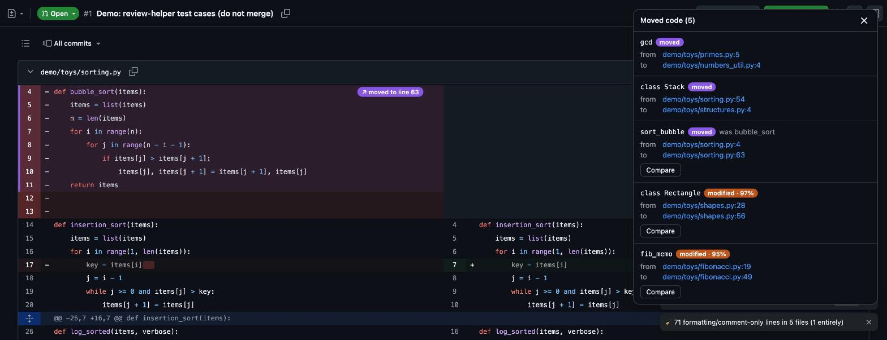
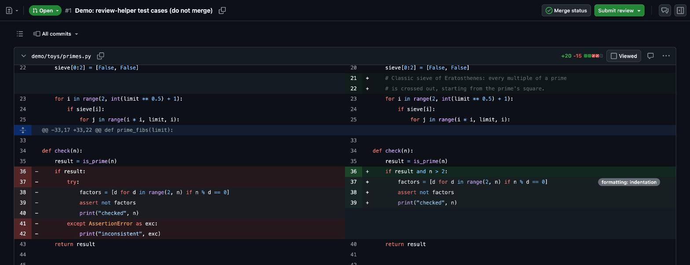
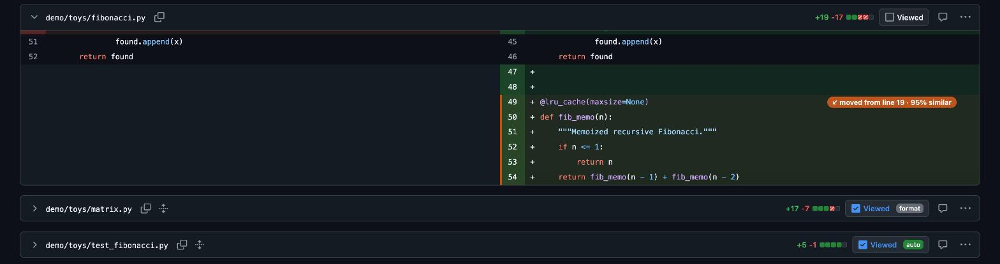
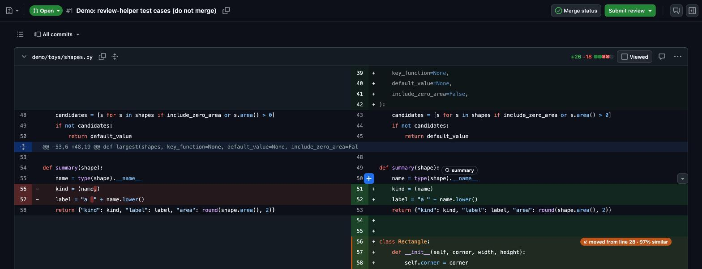
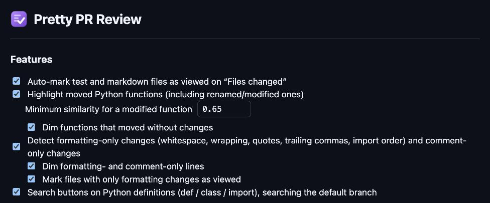
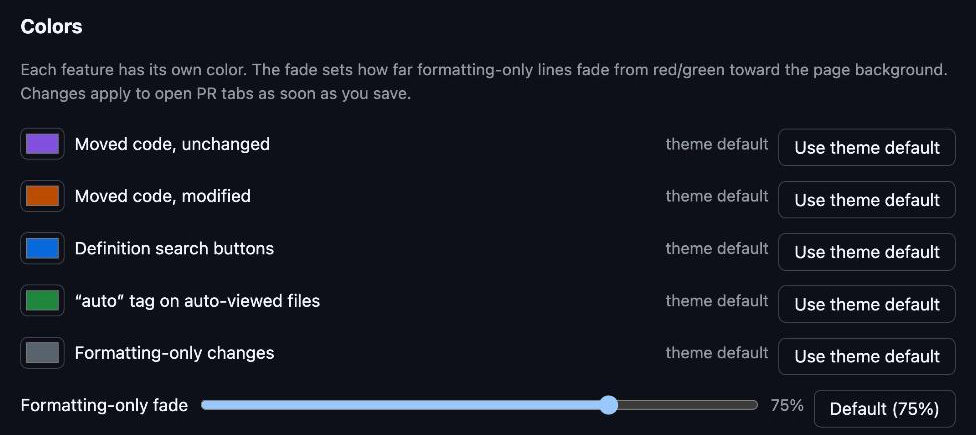
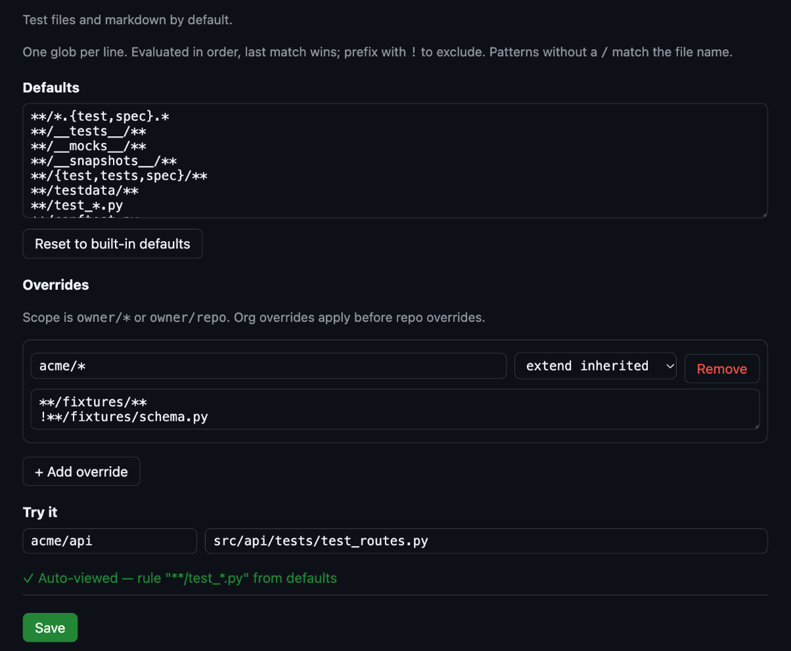

# Pretty PR Review

Chrome extension (MV3, WXT + TypeScript) for calmer GitHub PR reviews. Works without a token, using your normal GitHub session.

## Features

Screenshots are from the [demo PR](https://github.com/stodoran/pretty_pr_extension/pull/1), which has one of each case (see [demo/README.md](demo/README.md)).

### Moved code

Python functions and classes that moved, even renamed or modified, are tinted and labelled: purple when unchanged, orange when modified. Click a label to jump to the other end; **Show** lists every move, with a side-by-side **Compare** for modified ones.



### Formatting-only changes

Lines whose only change is formatting fade most of the way back to the page background. That covers whitespace, line wrapping, quote style, trailing commas, optional semicolons, reordered imports and re-indentation caused by a nearby real change. Comment and docstring changes spanning more than one line fade too. Hover one to highlight its section and see why it faded, for example *formatting: indentation* or *comment changes*. If any line of a statement really changed, the whole statement stays highlighted.

It works from the diff alone and knows Python, JS/TS, the C-family languages and CSS. For other files, only trailing whitespace counts as formatting. Markdown and plain text are never treated this way.



### Auto-viewed files

Files are marked as *Viewed* as they load when they're tests or markdown (tagged **auto**) or when every change in them is formatting (tagged **format**), so you can tell them apart from files you viewed yourself. Un-view one and it's left alone on that PR.



### Definition search

Hover any line of a Python function or class to get a search button on its `def`/`class` line (on import lines, one per imported name). It searches the repo's default branch for that name.



### Settings

Toggle features, pick each feature's color and how strongly formatting-only lines fade, and choose which files are auto-viewed, with per-org and per-repo overrides.







## Setup

```sh
npm install
npm run build        # → dist/chrome-mv3
```

1. `chrome://extensions` → Developer mode → **Load unpacked** → `dist/chrome-mv3`.
2. Optional: open the extension's options page to edit test-file patterns.

No GitHub token is needed. The extension clicks GitHub's own Viewed toggles, and GitHub saves that state with your normal session.

`npm run dev` runs WXT with hot reload, using a separate Chrome profile.

## Layout

| Path | Role |
| --- | --- |
| `src/core/registry.ts` | Detects PR pages (including SPA navigation) and runs enabled features |
| `src/core/feature.ts` | `Feature` interface: add new augmentations as modules in `src/features/` |
| `src/core/test-files.ts` | Pure glob classifier (defaults → `owner/*` → `owner/repo`, last match wins, `!` negates) |
| `src/github/dom/` | All GitHub-markup knowledge (`DiffDomAdapter`), so UI changes break only this layer |
| `src/core/ui/status-dock.ts` | Floating status panel in a shadow root that features write to |

## Behaviour notes

- Test files are marked viewed as they render. GitHub only renders files near the viewport, so files further down get marked as you scroll. The "x / y viewed" counter fills in as you go.
- If you uncheck a test file yourself, or click **Undo**, that file is remembered for the PR and never auto-marked again there. Re-checking it clears that memory.
- When a new push changes a file you'd viewed, GitHub shows it as not viewed again. Test files get re-marked in that case, unless you had unchecked them yourself.
